# Collaborative Document Editor


*Two browsers, one document: concurrent editing of the same paragraph, work continuing after the
network is cut, merging on reconnect, and a rollback to an earlier version. Recorded from
[a script](frontend/e2e/demo.spec.ts) that CI runs on every pull request, so the scenario cannot
quietly stop working while the image goes on showing it.*


*The same thing one layer up. Anna bolds a fragment; Marek, not seeing it yet, types a word in the
middle of it, and the formatting covers the new text instead of leaving a hole. Then a comment on a
selection, deleting the anchored text (the thread stays, marked detached), and restoring a document
from the bin.*

Real-time collaborative editing: several people in one document at once, over a bad connection, in
the same paragraph, with no server deciding who wins.

The merge algorithm is an RGA-style CRDT **written from scratch, twice** — Java on the server and
TypeScript in the browser. It is not a wrapper around Yjs or Automerge. Formatting, comments and
suggestions all run on that same core rather than beside it.

Everything about the project is in this file: what it does, how the algorithms work, the diagrams,
the numbers, and the parts that do not work.

**Contents**

- [Features](#features)
- [How the merge works](#how-the-merge-works)
- [Anchors: one mechanism, four features](#anchors-one-mechanism-four-features)
- [Undo in a shared document](#undo-in-a-shared-document)
- [History, and a diff by identity](#history-and-a-diff-by-identity)
- [Offline, reconnect, and the gap you cannot see](#offline-reconnect-and-the-gap-you-cannot-see)
- [The cluster](#the-cluster)
- [Authorization](#authorization)
- [Architecture](#architecture)
- [Running it](#running-it)
- [Tests](#tests)
- [Performance](#performance)
- [Failure modes](#failure-modes)
- [Limitations](#limitations)
- [Observability](#observability)
- [Repository layout](#repository-layout)
- [Licence](#licence)

---

## Features

**Editing**

- Any number of people in one document. A keystroke is visible locally immediately and reaches
  everyone else in about 130 ms with 50 clients connected.
- Offline editing. Operations go to an IndexedDB buffer that survives the tab closing and are sent
  on reconnect.
- Undo and redo that take back **your** operations, never someone else's.
- Live cursors and selections, and a participant list that works across backend instances.
- Large pastes: a chapter dropped into the editor is split into operations at the source, because
  nothing downstream is allowed to split one.

**Rich text**

- Bold, italic, underline, strikethrough, inline code, links.
- Headings, block quotes, lists — block structure expressed as marks over a line rather than nodes
  in a tree.
- Formatting survives concurrent editing inside its own range. This is the interesting one and it
  gets [its own section](#which-side-an-anchor-sits-on-decides-how-formatting-behaves).

**Comments**

- Threads anchored to a range of text; reply, resolve, reopen.
- Deleting the commented text keeps the thread, marks it detached, and shows the quote as of when
  it was written.
- A comment written with no connection goes to an outbox and is retried. Retrying one that did
  arrive does not create a second thread.

**Suggestions**

- Suggestion mode: your edits become proposals drawn over the real text instead of changing it.
- Accept or reject per suggestion; the resulting operations are generated server-side so a
  suggester can never write directly.

**History**

- Time travel to any point in the operation log.
- Diff between two versions **by character identity**, not by string.
- Restore, recorded as new operations rather than as a rewrite of the past.

**Documents and access**

- Workspaces, document list, full-text search over content, trash with restore.
- Four ordered roles: `viewer < commenter < editor < owner`.
- Invitation links that carry a role, stored only as a hash, expiring and revocable.
- Revoking access takes effect mid-session, on every instance.

---

## How the merge works

### The problem

Two people type into the same spot at the same time. Neither has seen the other. There is no
central sequencer to ask, and both must end up with the same document — not "eventually, after a
conflict dialog", but always, with no arbiter anywhere.

The naive answer is to send positions: *insert "!" at index 2*. That breaks the moment anything is
inserted earlier, because by the time the message arrives index 2 means a different place. Every
position-based approach ends up rewriting other people's messages to compensate. That is
Operational Transformation, and doing it correctly for N peers with no server is famously hard.

### Every character has an identifier

So we do not send positions. Each character gets an identifier when it is created and keeps it for
the life of the document:

```
Id = (replicaId, lamport)        printed as   1@7
```

`lamport` is a Lamport clock: bumped on every local edit, and bumped to
`max(local, incoming + 1)` on receipt of anyone else's operation. An insert names the character it
goes **after**, by identifier:

```
Insert { id: 1@7, originLeft: 1@6, text: "!" }
```

`originLeft` is a fact about the past that no later edit can change. That is the whole difference
from an index.

### Ordering two concurrent inserts

Both replicas hold `ok`. Ann is replica 1, Bo is replica 2, and both type at the end without having
seen the other:

```
   Ann   Insert{ 1@5, originLeft = k, "!" }
   Bo    Insert{ 2@5, originLeft = k, "?" }
```

Both operations reach both replicas, in whatever order the network feels like. The insertion rule
is: **find the origin, walk right while the block you meet has a higher identifier than the one
being inserted, and stop at the first lower one.** Identifiers compare by `(lamport, replicaId)`,
so `1@5 < 2@5`.

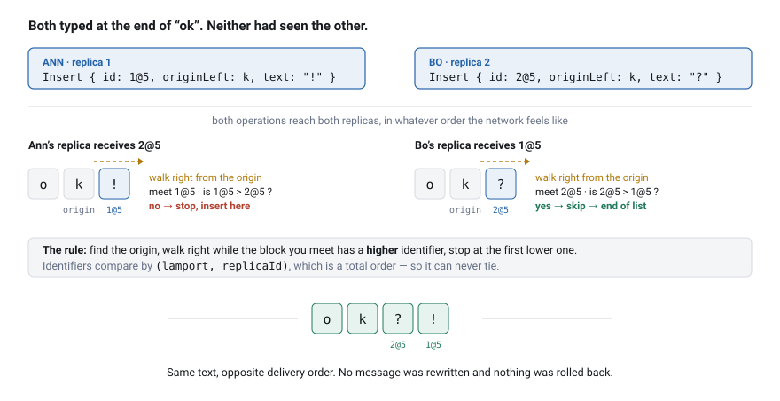

Same result, opposite delivery order, no messages rewritten and nothing to roll back. Higher
identifiers sort to the left, which is arbitrary but has to be *decided*, and the decision is a
total order on identifiers so it can never tie.

Two properties make the walk correct, and both rest on `lamport` being a real Lamport clock:

- Anything created causally after a block S has a higher timestamp than S, so skipping S skips its
  whole subtree. Concurrent runs never get shredded into each other.
- The first block past the origin's subtree has a *lower* timestamp than the origin, while the
  incoming block has a *higher* one — its author had seen the origin. So the scan stops on its own
  and never wanders out of the subtree.

### The document is a list of runs, not characters

Storing one object per character is wasteful and, worse, means one operation per keystroke. The
document is a list of **blocks**:

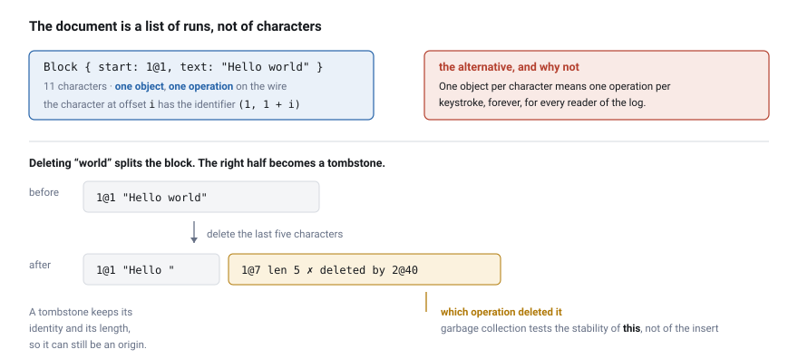

Two invariants keep this honest:

1. **A block is entirely alive or entirely deleted.** Deleting part of one splits it first. The
   alternative — a per-character flag array — complicates every index operation and saves little.
2. **The insertion scan is coarse, by blocks rather than characters.** That is safe because
   lamports inside a block increase and the characters are causally chained: if a block's first
   character outranks the incoming one, so does every other. The scan never needs to stop
   mid-block, because if the origin *is* mid-block, the block is split first anyway.

Typing appends into the previous block when the replica, the lamport and the origin all line up.
Without that fast path run-length encoding would buy nothing, since every keystroke is still its
own operation on the wire.

Deleting turns a block into a tombstone. It keeps its identity and its length so it can still serve
as an origin, and since CP18 it may drop its `text` while keeping both:

```
   before        Block{1@1,"Hello "}  Block{1@7,"world"}
   delete "world"                     ↓
   after         Block{1@1,"Hello "}  Block{1@7, len 5, ✗deleted by 2@40}
                                                          └─ WHICH operation
                                                             deleted it. GC needs
                                                             this; see below.
```

### Two index implementations, one algorithm

`RgaDocument` does not know how the block list is stored. It goes through a `BlockList` interface,
and there are two of them:

| | Insert a block | Find by offset | Find by identifier |
|---|---|---|---|
| `ArrayBlockList` | O(n) | O(n) | O(n) |
| `TreapBlockList` | O(log n) | O(log n) | O(log n) |

The treap is a binary search tree keyed by document order, with a heap priority for balance. Each
node carries its subtree's visible and total length:

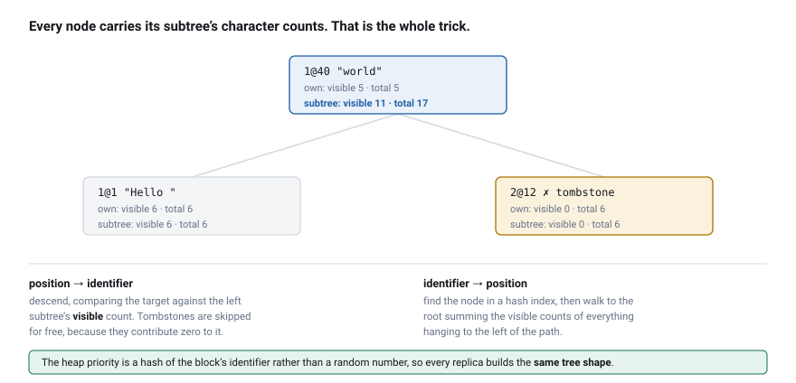

The priority is not random. It is a splitmix64 hash of the block's identifier, so every replica
independently builds **the same tree shape** — which makes a failing test reproducible instead of
merely likely.

Both implementations pass the same property suite, including
`BlockListEquivalenceProperties.naiveAndIndexedProduceIdenticalDocuments`, which feeds both the
same random operation sequence and compares step by step. Its companion
`bothImplementationsAnswerQueriesIdentically` is the one that earns its keep: a mutation once left
the *text* identical in both and only the *positions* wrong, which is a document that looks healthy
with everybody's cursor in the wrong place. A comparison on text alone missed it.

The order of work was deliberate: naive implementation, then the full test suite, then JMH
measurement, and only then the tree. The commit history shows that sequence because it is more
honest than dropping in a clever structure on day one.

### Tombstones, and when one can be dropped

Tombstones can never be deleted on a whim: another replica may still be holding an operation whose
origin is that character. The condition for dropping one is **causal stability** — every replica
that could still refer to it has already seen the deletion.

The server keeps the version vector each connected replica reports, and takes the component-wise
minimum:

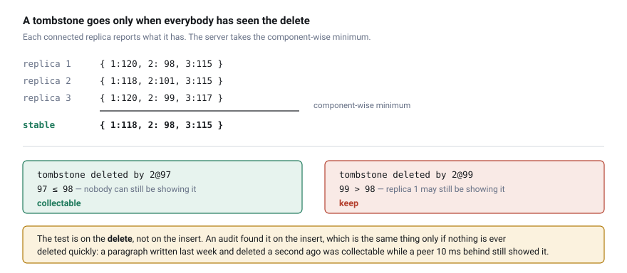

The test is on the **deletion**, not on the insertion. An audit found it applied to the insertion,
which is the same thing only when nothing was ever deleted quickly: a paragraph written last week
and deleted a second ago has an insertion far below the meet, so its tombstone was collectable
immediately while a peer 10 ms behind was still displaying the text. That is what `Block.deletedBy`
is for, and `GcSafetyTest` pins the scenario.

Two more things are protected from collection, both found the same way:

- **Anchors of buffered operations.** A mark waiting for one anchor to arrive still needs the other
  one to exist. Collecting it stranded the operation in the pending buffer for the life of the
  process, and the formatting silently vanished.
- **Every character in a buffered delete range**, not just the first. The range walk goes block by
  block, so removing anything in the middle breaks it permanently.

A replica offline for longer than the GC window (7 days) is refused explicitly with
`RESYNC_REQUIRED` and its local version is saved as a separate "Recovered draft". No faked merge:
the information about where those characters belong is genuinely gone.

### Why deduplication is not the version vector's job

The reflex is to keep a version vector and reject anything already seen. That is wrong with a
Lamport clock, because **per-replica counters are not contiguous** — the clock jumps whenever
someone else's operation arrives. Replica A may legitimately produce lamports 1, 2, 47, 48, 103.
"I have everything from A up to 48" cannot distinguish a hole left by a lost message from a hole
left by a clock jump.

Instead:

| Operation | How a duplicate is detected |
|---|---|
| `Insert` | Is a character with that identifier already in the structure? Exact, and free — the structure indexes by identifier anyway. |
| `Delete` | Not detected at all. Setting a tombstone twice is a no-op; delete is idempotent by nature. |

The version vector still exists, for causal stability above and for the "what do you have" exchange
on reconnect. It is not a correctness mechanism of the core.

That separation is deliberate and worth naming: **detecting gaps in delivery is the transport's
job, not the algorithm's.** The CRDT has to be correct under any order and any repetition, and it
is.

### What the Lamport clock is actually for

The first version of this project's notes claimed that without bumping the clock on receipt the
implementation **diverges**, and gave a counterexample. That claim was too strong and is withdrawn.

I removed the bump from production code (`clock = max(clock, 0)`) and ran a brute-force divergence
search: 200 000 random scenarios, 3–5 replicas, 30 edits each, aggressive interleaving of
generation and delivery, full exchange in random order, every operation delivered twice.

**Zero divergences. Zero operations stuck in the buffer.**

The counterexample does not reproduce under manual tracing either. The integration function is
deterministic with respect to the *set* of present elements rather than the order they arrived in,
and that is enough for convergence whether or not the timestamps respect causality.

The bump stays, for an honestly named reason: it is a premise of the published RGA correctness
proof, convergence without it here is *observed* rather than *proven*, and 200 000 random scenarios
are strong evidence rather than a proof. What it does guarantee is the structural property above —
skipping a sibling skips its subtree, so a concurrently typed run stays contiguous. That is an
invariant about the linearisation, not about two replicas agreeing.

Which matters, because for a long time nothing was checking it. The property suite did not catch
that mutation, and a paragraph in this repository claimed for months that a fix had made it catch
it. The scenario that fix added (`convergenceWithInterleavedDelivery`) does *execute* the clock rule
— it was aimed at a real blind spot and it closed it — but executing a rule and detecting its
absence are different things, and only the first was ever verified. The property was pointed at the
one observable the mutation is known not to disturb.

The real fix is three lines in `RgaInvariants`, the helper every property already calls after each
step: assert that a block's timestamp is above its origin's. Unmutated, green. Mutated, red.

**How it was found matters more than the fix.** Not by reading the code, and not by anyone spotting
the flaw in the argument — by re-running the mutation against a suite that had grown by four
checkpoints since the claim was written. A mutation result is a fact about the suite *at the moment
it was measured*, and this repository had been quoting one from CP2 ever since.

---

## Anchors: one mechanism, four features

Cursors, formatting, comment highlights and suggestions are all "a place in the document that has
to survive other people typing". They are all the same object:

```java
Anchor { charId: Id, side: BEFORE | AFTER }
```

Not an offset — an offset stops pointing at the same place the moment somebody inserts text
earlier. An anchor is attached to a character, so it moves with the text.

### Which side an anchor sits on decides how formatting behaves

This is the heart of rich text in a CRDT and the easiest part to overlook. An anchor "after X" and
an anchor "before Y" point at the same gap in `…XY…` — until somebody inserts between X and Y.
Then they differ, and that difference is exactly what decides whether formatting grows:

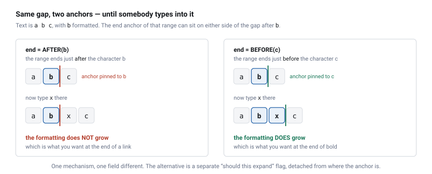

Typing at the end of a bold run should be bold. Typing at the end of a link should not join the
link. Same mechanism, one field different. The alternative is a separate "should this expand" flag,
which describes the same thing worse — because it is detached from where the anchor actually is.

The table of which types expand lives in
[`conformance/schema/mark-types.json`](conformance/schema/mark-types.json), read by both
implementations, with a test on each side that fails if they drift. An unknown type does not
expand: a mark that expands unexpectedly changes the look of text the user never formatted, while
one that fails to expand costs a repeated gesture.

### Formatting is a layer, not a character attribute

Marks are a separate CRDT layer over the character layer, in the style of Peritext. The character
layer never gained a field for bold, or for comments, or for suggestions.

This is what the second demo GIF shows. Ann bolds `llo` in `Hello world`; Marek, who has not
received the mark yet, types `XX` in the middle of it:

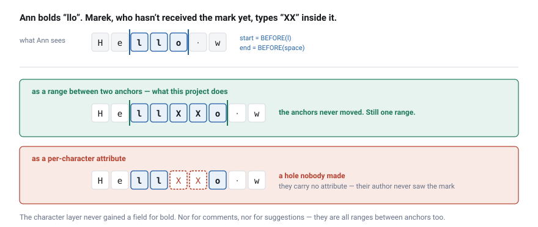

Resolving marks to spans is a sweep over the block list. Because "the sweep agrees with itself on
every replica" is a test that passes when the sweep returns nothing at all, it is checked against
`NaiveMarkResolver` — an independent, obviously correct, far too slow implementation that resolves
anchors straight from the block list. Replacing `MarkSet.spans` with `return List.of()` left all
four of the original mark properties green. It does not survive the oracle.

Twelve mark types share the mechanism: six inline styles, `comment`, two suggestion types, and
`heading` / `quote` / `list` for block structure.

### A comment is half in the CRDT and half out

The common misreading of this codebase is "there is a CRDT, so the comments must be in it". They
are not. The **anchor** is a CRDT operation. The **conversation** is rows in Postgres.

The reason is that they need different things. A range has to merge without an arbiter under
concurrent edits — that is a CRDT problem. A sentence written by one person has a single author and
an obvious order; running it through a merge algorithm buys nothing and costs a lot.

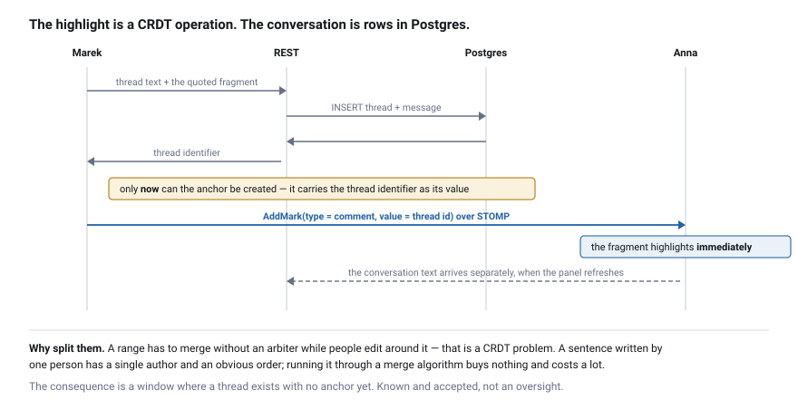

Two consequences are easy to miss in the code:

1. **The anchor is created after the thread**, because it needs the thread's id. Between the two
   there is a window where a thread exists with no anchor. That is a known, accepted consequence of
   the split rather than an oversight.
2. **The highlight and the content travel by different routes at different speeds.** The highlight
   is a CRDT operation and appears for everyone immediately; the conversation goes over REST and
   waits for the panel to refresh. It looks like an inconsistency and is not.

Offline, a comment goes to an outbox with its anchor and is retried on reconnect. Retrying one that
actually did arrive is recognised by an idempotency key and does not become a second thread — the
offline path here needs exactly-once, not merging.

### Suggestions are marks over real text

A suggestion does not modify the document and does not live in a side buffer. Typing in suggest
mode produces text that is really inserted, carrying a `suggest-insert` mark; deleting produces a
`suggest-delete` mark over text that is still there. Accepting means dropping the mark. Rejecting
means generating the operations that undo it — **server-side**, so a role that may suggest can
never write directly, whatever the client sends.

That is the payoff of the mark layer being general. Suggestions needed no new anchor mechanism, no
new merge rule and no change to the character layer.

---

## Undo in a shared document

CodeMirror's own history is switched off. It works on text, so an undo would also take back
whatever other people typed in the meantime — in a shared editor that is not an inconvenience,
it is deleting someone else's work.

Undo therefore operates on **your own operations**, and here is the difficulty: in a CRDT an
operation cannot be inverted. A deleted character has a tombstone and does not come back to life.
Restoring text means inserting **new** characters with new identifiers. The visible effect is the
same; the identity is not. Yjs does the same thing.

A stack entry remembers a **character identifier**, not an offset — an offset recorded at edit time
is stale by the time you press Ctrl-Z, because other people have been typing.

Undoing a formatting change is not "remove the mark" either. The inverse of "make this bold" is
"put back whatever this range had before", which differs whenever somebody else's mark of the same
type was already there. Removing would take away their formatting too, and they never touched
anything.

If the anchor has since been deleted by somebody else, the entry is **skipped**, not guessed at.
Putting the text back "roughly there" would be worse than doing nothing: it would appear somewhere
random with no explanation.

---

## History, and a diff by identity

The operation log in Postgres is the source of truth. Snapshots are a disposable cache — deleting
every snapshot in the database changes only how long a load takes, and there is a test that does
exactly that (`snapshotsAreOnlyACache`).

That buys time travel for free: `GET …/history/at?seq=` replays the log to any point. Restoring is
recorded as **new operations** rather than a rewrite, so the history of a restore is itself in the
history.

The diff endpoint compares two versions by **character identity**, which answers a question a text
diff cannot:

```
   delete a word, then type the same word again

   text diff        "the quick fox"  vs  "the quick fox"   →  no change
   identity diff    1@40..1@44 gone, 2@81..2@85 new        →  a change,
                                                              by a named author
```

Restore uses a common prefix and suffix rather than a full Myers diff. A restore is usually a
rollback of one recent edit, so prefix/suffix is short and cheap; Myers would produce smaller
operations at a cost in complexity that has not been worth paying.

---

## Offline, reconnect, and the gap you cannot see

Losing the connection is the normal case, not the exception. Editing continues into an IndexedDB
buffer that survives the tab being closed, and drains on reconnect.

What decides when an operation may leave that buffer is the interesting part:

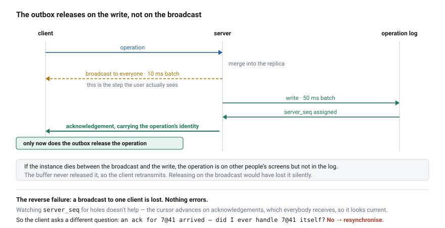

The release is on the **write** acknowledgement, never on the broadcast. If an instance dies in
between, the operation is on other people's screens but not in the log — and because the buffer
never released it, the client retransmits.

The reverse failure is the one worth designing for, because it is silent. A broadcast to one client
is lost. Nothing errors; the client simply has a hole and does not know it. Watching `server_seq`
for gaps does not help, because the cursor advances on **acknowledgements**, which are broadcast to
everybody — so it looks perfectly current while the operation is missing.

So the acknowledgement carries the operation's **identity**, and the client asks a different
question:

```
   ack for 7@41 arrives  →  have I actually handled the operation 7@41?
                            no  →  a broadcast was lost  →  resynchronise
```

That check was originally "does my replica contain a character 7@41", which is exact for inserts
and always false for deletes and marks — their identity is drawn from the same clock but never
names a character. So one backspace by anybody set the gap flag, and the client then asked for a
**full resynchronisation from zero** every 15 seconds, for ever. The repair mechanism was its own
permanent load. It is now a bounded window of handled identities, with the structural check kept as
a second line.


The heartbeat is not what the user experiences. The client listens for the browser's
`online`/`offline` events and for socket errors, which fire immediately. The broker's timeout is
the backstop for a socket that is dead without saying so.

---

## The cluster

Every backend instance is an ordinary CRDT replica — a peer of the other instances and of the
browsers. No leader, no distributed lock, no sticky sessions.

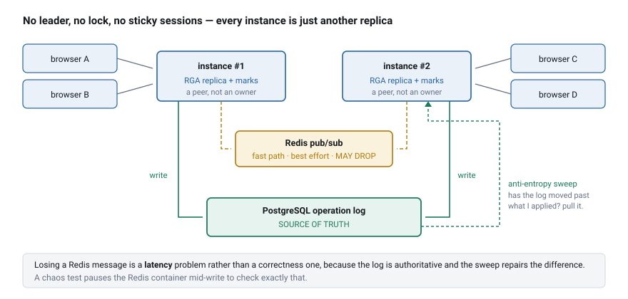

Redis is a fast path, not a channel with delivery guarantees. Losing a message is a **latency**
problem rather than a correctness one, because the log is authoritative and the sweep repairs the
difference. `ClusterChaosIT` pauses the Redis container mid-write to check that, and
`redisOutageIsRepairedByAntiEntropy` checks the repair specifically.

There is a deterministic simulation of the whole cluster as well: the same scenarios driven from a
seed instead of from thread interleaving, so a failure arrives with the number that reproduces it
rather than with "sometimes".

The cost of having no owner is on the [limitations](#limitations) list: a document open on three
instances lives in three copies.

---

## Authorization

Two doors — HTTP and WebSocket — and one `PermissionService` behind both. The interesting part is
the HTTP side, where the rule is **declare what you need, or you are not served**.

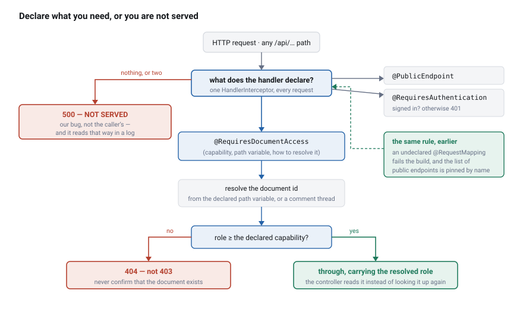

Three things in that picture are the whole of it, and each answers a hole that actually shipped
here:

1. **The default branch refuses.** A request-mapped method that declares neither annotation is
   answered with 500 and never reaches the controller. A new controller therefore starts *broken
   and loud* rather than open and quiet — which is what `HistoryController` was for a whole
   checkpoint, handing out the full content of any document and letting a reader **overwrite** it.
   500 rather than 404 is deliberate: this is our bug, not a caller doing anything wrong, and it
   should read that way in a log.
2. **The document id comes from the declaration**, not from wherever the handler happens to look.
   That is why creating a comment is `POST /api/documents/{id}/comments` with the document in the
   path: an authorization mechanism that resolves its subject from a declaration cannot be pointed
   at an endpoint that keeps its subject in the body.
3. **The build enforces the same rule as the runtime.** An undeclared mapping fails
   `EndpointAuthorizationArchitectureTest`, and `publicEndpointsAreExactlyTheExpectedOnes` pins the
   exemption list by name, so silencing the guard shows up in the diff. The runtime guard alone
   would be a rule you discover by breaking production; the test alone would be a rule anyone can
   delete.

**What it does not claim.** The guard checks that a decision was *made*, not that it was the
*right* one. `@RequiresDocumentAccess(READ)` on something that writes is declared, consistent, and
wrong, and nothing here would notice.

On the WebSocket side, `DocumentAccessInterceptor` checks **every** SEND and SUBSCRIBE frame,
resolving the document from the destination. It is not "do you have access to the document" but
"does your role permit *this* operation" — comments and edits travel the same channel, so the
distinction has to descend to the operation type.

An unresolvable destination is refused. It used to be passed through, on the reasoning that it must
be one of the user's own private queues. Spring's simple broker matches subscription destinations
as **Ant patterns**, so `SUBSCRIBE /topic/**` resolved to no document, went through unchecked, and
then matched every document's broadcast. Wildcards are now refused before anything else, and
`DocumentAccessInterceptorTest` pins both that and the broker behaviour that made it matter.

---

## Architecture


All four RGA replicas above — two in browsers, two in backend instances — are peers. Authorization
is drawn on one instance only to keep the picture readable; it runs on every one.

The modules:

```
crdt-core/     the algorithm. A separate Maven module with ZERO Spring dependencies,
               so it can be tested and benchmarked in isolation and so the compiler
               stops the application layer leaking into it.
               Block, RgaDocument, MarkSet, Anchor, {Array,Treap}BlockList,
               OpCodec, SnapshotCodec, VersionVector + property tests + JMH

app/           Spring Boot 3, Java 21
  ws/          STOMP, presence, per-frame authorization, rate limiting
  auth/        roles, permissions, invitations, tokens
  domain/      the in-memory document replica
  persist/     operation log, snapshots, document catalog, search
  history/     time travel, diff, restore
  comments/    threads and messages (content outside the CRDT)
  suggestions/ accept and reject, server-side operation generation
  cluster/     Redis pub/sub, anti-entropy, permission invalidation

frontend/      React + TypeScript + Vite
  crdt/        the second RGA implementation + mark layer + undo
  transport/   STOMP client, offline buffer, gap detection, network simulator
  editor/      the CodeMirror 6 bridge, formatting, remote cursors
  ui/          document list, history, comments, suggestions, sharing

conformance/   test vectors and the mark-type table shared by both implementations
```

### The path of a single edit

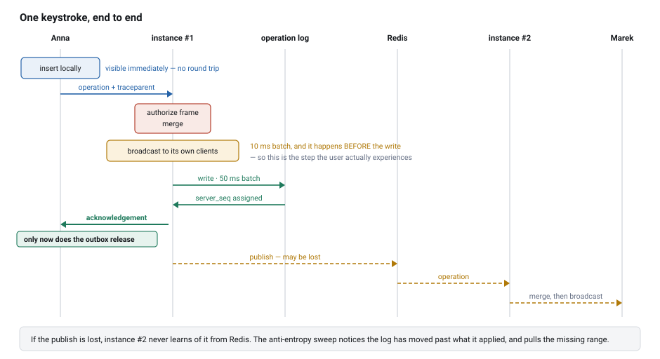

### Two implementations, one corpus

The algorithm exists twice, in two languages, and they have to agree exactly — a browser and a
server that order two concurrent inserts differently produce a permanently split document.

Keeping them in step is a shared corpus in [`conformance/`](conformance/): operation sequences with
their expected resulting text and formatting, generated once and replayed by both test suites. A
change to the ordering rule in one language fails the other language's build.

The corpus does not cover everything, and it is worth being precise about the hole. Vectors contain
operations that were **already created**, carrying concrete anchor sides. "Does bold grow when you
type at its end" is decided at *creation* time, so changing the expansion table on one side changes
no vector at all and the whole corpus stays green. That is why the table is a JSON file both sides
read, with a conformance test on each side — including one that walks the *other* way, from the
declared constants to the file, because a type declared in Java and forgotten in the JSON left both
suites green while the client had no idea the type existed.

---

## Running it

Requirements: JDK 21, Node 22.12+, Docker.

```bash
docker compose --profile app up -d      # everything, on http://localhost:3000
```

The first run takes a few minutes to build the images. To work on the code instead:

```bash
docker compose up -d postgres redis

# Required, with no default: the server refuses to start without it. A secret committed to the
# repository would let any reader mint a token for any user. Compose and CI set their own.
export COLLABEDIT_AUTH_SECRET=$(openssl rand -base64 32)

./mvnw -pl app spring-boot:run              # backend on :8080
cd frontend && npm install && npm run dev   # frontend on :5173
```

<details>
<summary>If you use colima rather than Docker Desktop</summary>

Testcontainers does not read the docker context, and Docker 29+ rejects the API version
docker-java negotiates by default. All three symptoms read as "no Docker":

```bash
# "Could not find a valid Docker environment"
export DOCKER_HOST=unix://$HOME/.colima/default/docker.sock
# "error while creating mount source path ..." — the socket path inside the VM, for Ryuk
export TESTCONTAINERS_DOCKER_SOCKET_OVERRIDE=/var/run/docker.sock
# "client version 1.32 is too old"
echo "api.version=1.44" > ~/.docker-java.properties
```

None of this is needed on GitHub runners.
</details>

Deploying somewhere that is not a laptop: the frontend resolves the backend address at build time
([`frontend/src/config.ts`](frontend/src/config.ts)) and defaults to the origin it was served from,
with nginx proxying `/api` and `/ws`. That is the only arrangement that works over TLS, since a
page served over `https:` may not open a `ws:` socket. For separate origins, set `VITE_API_BASE` at
build time and `COLLABEDIT_WEBSOCKET_ALLOWEDORIGINPATTERNS` on the backend.

---

## Tests

```bash
./mvnw install                         # everything, integration tests on a real Postgres
./mvnw -pl crdt-core test              # property tests (1000 tries, random seed — it searches)
./mvnw -pl crdt-core -Pthorough test   # 10 000 tries, as in the nightly run
cd frontend && npm test                # client unit tests
cd frontend && npm run e2e             # two browsers, needs a running stack
```

A failing property prints its seed; `@Property(seed = "…")` replays it.

| Layer | Tests |
|---|---:|
| `crdt-core` — property, structural invariants, conformance vectors, snapshot bytes, marks, GC safety | 87 |
| `app` — integration on a real Postgres and Redis: cluster chaos, permissions, presence across instances, the architecture test, the frame interceptor | 227 |
| `frontend` — agreement with the Java implementation, the CodeMirror bridge, snapshot decoding, undo, gap detection, the offline store | 134 |
| end-to-end — two browser contexts, every spec failing on an uncaught console error | 21 |
| **total** | **469** |

The deterministic cluster simulation is counted separately, because folding it in would turn an
honest number into a marketing one: 1207 is a count of **seeds**, not of distinct assertions, and
the nightly run raises it to 20 000 per scenario. Its value is that a failure arrives with the seed
that reproduces it, not that there are a lot of them.

Tests are organised by the failure mode they catch rather than by coverage. The ordering that
matters:

1. **Property tests of the algorithm.** Random operation sequences delivered in random order, with
   repetition, must always converge — plus the structural invariants a convergence check cannot
   see, and equivalence between the naive and indexed implementations on *query answers*, not only
   on text.
2. **Integration tests against a real Postgres and Redis** through Testcontainers, not mocks.
3. **Chaos and deterministic simulation**: random delays, dropped messages, paused containers,
   driven from a seed.
4. **Then** the ordinary unit tests.

**The tests get checked too.** I mutate production code and check the suite goes red. That has
found three tests that verified nothing, and each failed differently:

- Removing the Lamport clock bump left all fifteen property tests green, while four comments
  claimed they existed to catch exactly that. [Full story above.](#what-the-lamport-clock-is-actually-for)
- Removing the treap's aggregate update after a tombstone sailed through convergence, because every
  replica was wrong in the same way. The text agreed; only the positions were wrong.
- `garbageCollectionSparesMarkAnchors` passed with the mechanism it tested switched off. I had
  anchored the mark mid-text, where a rule from CP2 was already protecting the character. The test
  was checking the old rule and crediting the new one.

The common denominator is uncomfortable: **a test written to check mechanism X may be passing
thanks to mechanism Y**, and there is no way to notice other than by breaking X and seeing whether
anything reports it. Load harness, JMH benchmarks and the fan-out measurement are excluded from the
normal run — they take minutes and measure the machine as much as the system, so they run
explicitly and nightly.

---

## Performance

All numbers from one machine: MacBook, Apple Silicon, 10 cores, JDK 25-ea, 4 GB heap, with Postgres
and Redis in containers alongside. Full tables, methodology, and the claims that turned out to be
wrong once measured, are in [`docs/performance.md`](docs/performance.md).

Index structure, JMH, at 100 000 characters:

| Operation | `ArrayBlockList` | `TreapBlockList` |
|---|---:|---:|
| Position → identifier | 60.2 µs | **0.286 µs** |
| Identifier → position | 40.3 µs | **0.210 µs** |
| Reading the whole text | 310 µs | 429 µs *(treap slower)* |

The shape matters more than the values: for a tenfold larger document the naive scan grows about
13×, the treap about 2×. Reading the whole text is 40% slower in the treap because walking a tree
has worse locality than iterating an array. That runs once per document open while lookup runs on
every keystroke, so it is an easy trade — but it is a trade, not a free win.

Propagation between clients, from the load harness. All twelve scenarios converge:

| Document | Clients | p50 | p99 |
|---:|---:|---:|---:|
| empty | 50 | 202 ms | 374 ms |
| 10 000 chars | 50 | 135 ms | 230 ms |
| 100 000 chars | 50 | 124 ms | 1299 ms |

Document size barely affects median latency. The p99 tail at 100 000 characters is the rate limiter
rather than the algorithm; `docs/performance.md` has the measurement that disproved my first
explanation of it.

One earlier finding is worth repeating because it was mine, not the system's. "Above ~10 clients
convergence stops being repeatable" turned out to be a default 8 KiB buffer in the *test client*,
which let broadcasts through and blocked only the resynchronisation responses — the one mechanism
that can repair a lost operation.

---

## Failure modes

What actually happens when something goes wrong. Rows naming a test have one that checks them.

| Scenario | Behaviour | Verified |
|---|---|---|
| **Connection lost mid-edit** | Editing continues. Operations go to an IndexedDB buffer that survives the tab closing, and are sent on reconnect. | e2e network-cut and reload specs |
| **Browser refuses local storage** | Editing and the socket carry on; the user is told once that unsent changes would not survive the tab closing. The buffer is a safeguard, the socket is the product. | `USER_FACING_ERRORS` (needs a browser that refuses IndexedDB) |
| **Instance dies between broadcast and write** | The operation is on other clients but not in the log. The client retransmits, because its buffer releases on the **write** acknowledgement, never on the broadcast. | outbox release rule, above |
| **Replica lost, or instance restart** | Rebuilt from the log: nearest snapshot plus tail. Deleting every snapshot changes only the time taken. | `stateSurvivesReplicaLoss`, `snapshotsAreOnlyACache` |
| **Redis outage** | Editing and writing continue. Instances diverge for the outage and the anti-entropy sweep pulls the difference from the log. An overloaded listener pool discards and counts messages rather than running them on the receiving thread. | `redisOutageIsRepairedByAntiEntropy` |
| **Broadcast to a client lost** | The client notices an acknowledgement for an operation it never received and asks to resynchronise. A `server_seq` cursor is not enough: it advances on acknowledgements, so it would look current despite the gap. | gap-detection tests |
| **Two people edit the same character** | Both kept, ordered deterministically by `(lamport, replicaId)`, no arbiter. | `concurrentEditOfSameCharacterKeepsBoth`, property `convergence` |
| **Client offline longer than the GC window (7 days)** | Refused explicitly (`RESYNC_REQUIRED`) and the local version saved as a separate "Recovered draft". No faked merge: where those characters belong has been lost. | `staleOperationIsRejectedExplicitly` |
| **An operation arrives before its cause** | Buffered and retried after every successful merge. Not confused with the case above: refusal needs both a missing origin and a position below the GC boundary. | `operationAheadOfItsCauseIsNotRejected` |
| **Very large document** | Size barely affects latency after swapping the index for a treap. Tombstones grow with edit count, and GC reclaims less than I assumed. | JMH, load harness |
| **50 clients in one document** | Converges repeatably, including in a 100 000-character document. | `BroadcastFanoutIT`, load harness |
| **Rate limit exceeded** | The frame is refused, the client is told the exact wait and retries from its buffer with backoff. A refusal for permission is silent, since saying the document exists would leak; a refusal for pace is not, because a silent one is data loss. | harness: 351 rejections, zero lost operations |
| **Deleting formatted text** | Formatting stays on what survived. Mark anchors are tombstones protected from GC, or the appearance would vanish at the next snapshot rather than at the edit. | `garbageCollectionSparesMarkAnchors` |
| **Deleting commented text** | The conversation stays, marked detached, quoting the fragment as of when it was written. | `threadSurvivesDeletionOfAnchoredText` |
| **A role without write permission** | Read-only editor, greyed formatting bar, no comment input, because the role arrives with the initial state. The server checks as before; the client stops offering a gesture that would be refused. | `openedDocumentCarriesCallersRole` |
| **Access revoked mid-session** | Takes effect on every instance: immediately on the acting one, and on the invalidation message elsewhere, with the 5 s cache TTL as the floor for a lost broadcast. Live subscriptions are re-checked per frame rather than grandfathered — the session survives, the permission does not. | `revokedAccessTerminatesLiveSubscription`, `PermissionClusterInvalidationIT` |
| **A stranger opens a document link** | Nothing. Documents created through the interface are private; getting in needs an invitation carrying a role, or a deliberate switch to link visibility. The refusal is the same 404 as for a document that does not exist. | `AccessIT` |
| **A signed-in stranger subscribes to a topic directly** | Refused on the channel and counted by reason. The interceptor resolves the document from the destination and checks the role per frame; unparseable destinations and STOMP wildcards are refused, because the broker's pattern matching runs after the interceptor. | `DocumentAccessInterceptorTest` |
| **An invitation link is forwarded** | It works. An invitation is a bearer credential and there is no second factor in a system without passwords. Mitigated rather than solved: invites expire, can be revoked, and are stored only as a hash. | see [Limitations](#limitations) |
| **A comment written with no connection** | Held in an outbox with its anchor and retried on reconnect. A retry of an attempt that did arrive is recognised by key and does not become a second thread: the offline path needs exactly-once, not merging. | `retryingAnUncertainCommentDoesNotDuplicateIt` |
| **Pasting a chapter** | Split into operations of at most 8192 characters at the source. An operation larger than a frame can be neither sent nor received, and nothing downstream can split one, because its identity is what merging is built on. | `SyncChunkingTest`, `LargePasteIT` |
| **The cluster channel is unreachable** | Editing continues and the participant list says it may be incomplete — the one place best-effort is shown to the user, because a quietly short list looks exactly like a document nobody else is in. | `PresenceClusterIT` |
| **Two people move the same paragraph** | **Two copies of it.** The replicas agree, so the algorithm's guarantee holds and the result is still wrong. A move is a delete plus an insert, because a paragraph has no identity in a flat sequence. | `concurrentMovesOfTheSameParagraphDuplicateIt` |

---

## Limitations

Deliberate simplifications, and the ones that turned out worse than I assumed.

- **No paragraph identity, so no move operation.** Two people moving the same paragraph get two of
  it. Block structure is marks over a flat sequence, which is what makes it merge cleanly with
  everything else and also what makes this unfixable without giving paragraphs identity — a rewrite
  of the layer everything else stands on. A real fix is a tree CRDT for structure with the sequence
  CRDT inside each node.
- **A document open on three instances lives in three copies.** The declared cost of having no
  document owner. Per-replica memory has never been measured, so `max-loaded-documents: 200` is an
  order-of-magnitude guess rather than a capacity plan. At real scale this wants either
  document-affinity routing or a measured eviction policy, and I would want the measurement first.
- **Auth is deliberately thin.** Passwordless login, a signed token, no accounts, no refresh
  rotation. The subject here is distributed data consistency, not identity management; in
  production this is an OIDC provider's job.
- **Invitations are multi-use** until they expire or are revoked. That is what "anyone with this
  link" means when there are no addressable users, but it is weaker than it sounds, and a
  single-use invite bound to an email address would be the first thing to add.
- **The authorization guard checks that a decision was made, not that it was right.** A read
  capability declared on a write endpoint passes.
- **The performance numbers come from a single process,** with clients, server and database on one
  machine, so they exclude real network latency and real disk contention.
- **GC reclaims less than I assumed.** Causal stability needs every replica to have seen the
  deletion, and a single client that closed its laptop holds the window open for everyone in that
  document until it times out.
- **A cluster message for a document whose replica is still loading is dropped,** and anti-entropy
  cannot detect it afterwards, because the fresh replica is labelled at log head so
  `head > appliedServerSeq` is never true. A client on that instance can stay permanently one
  operation behind. Known, reproduced under load, not fixed — the fix needs a design decision about
  the cluster load path rather than a patch.

---

## Observability

```bash
docker compose --profile observability up -d   # Prometheus, Tempo, Grafana on :3001
```

Use the backend started from Maven on the host, not `--profile app`: the containerised backend sets
`OTEL_SDK_DISABLED` unconditionally, so a browser span arrives with no server span to join and the
trace looks broken rather than disabled.

One keystroke produces a single trace across two services: `edit.submit` in the browser, then
`op.receive`, `crdt.merge` and `op.broadcast.local` on the server. The context travels in a STOMP
frame header, because the WebSocket handshake happens once per session and an HTTP header would
describe the session rather than the edit. The write to the log is attached by **links** rather
than nesting, since one write covers many operations from different traces.

Metrics worth knowing about: active sessions, propagation latency percentiles, operations merged,
conflicts resolved, characters reclaimed by GC, cluster messages dropped, frames refused by reason.

The [dashboard](ops/grafana/dashboards/collabedit.json) is a file in the repository. Each panel says
what a bad value looks like, including that a permanently zero count of gap repairs is not good news
but a sign the repair path has never run.

---

## Repository layout

```
crdt-core/     RGA algorithm + mark layer + property tests  (zero Spring)
  src/jmh/     the benchmarks behind the numbers above
app/           Spring Boot: WebSocket, persistence, history, cluster, auth
  src/test/…/simulation/   the deterministic cluster simulation
  src/test/…/LoadHarnessIT the load harness
frontend/      React + TypeScript + CodeMirror 6
conformance/   test vectors and the mark-type table shared by both implementations
ops/           Prometheus / Tempo / Grafana / OTel Collector configuration
tools/         helper scripts (demo recording, data cleanup)
docs/          performance measurements, the original brief, work plans
```

Recording the demo:

```bash
./tools/reset-demo-data.sh
cd frontend && npm run demo
cd .. && ./tools/make-gif.sh core docs/demo.gif && ./tools/make-gif.sh product docs/demo-v2.gif
```

## Licence

MIT — see [`LICENSE`](LICENSE).
