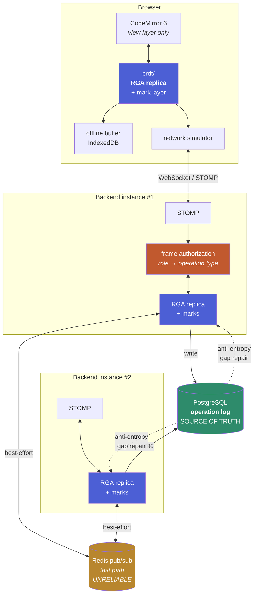
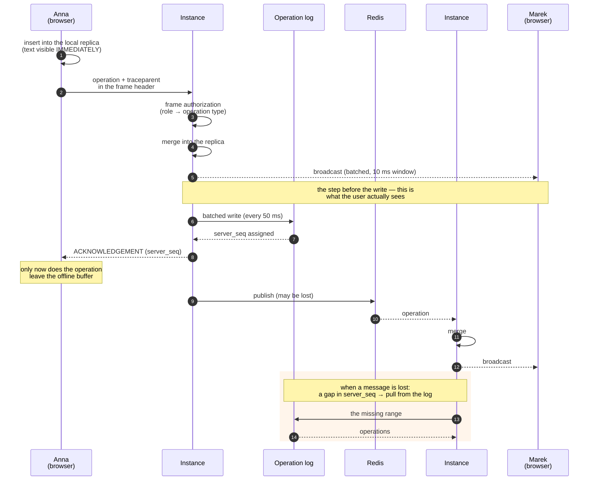
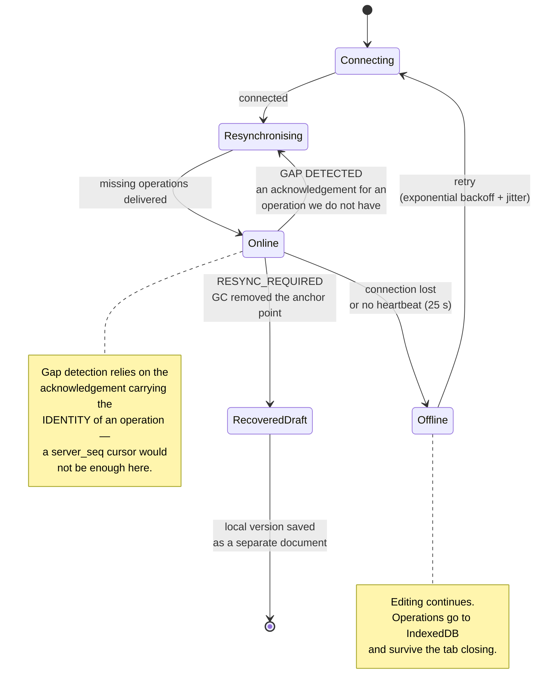
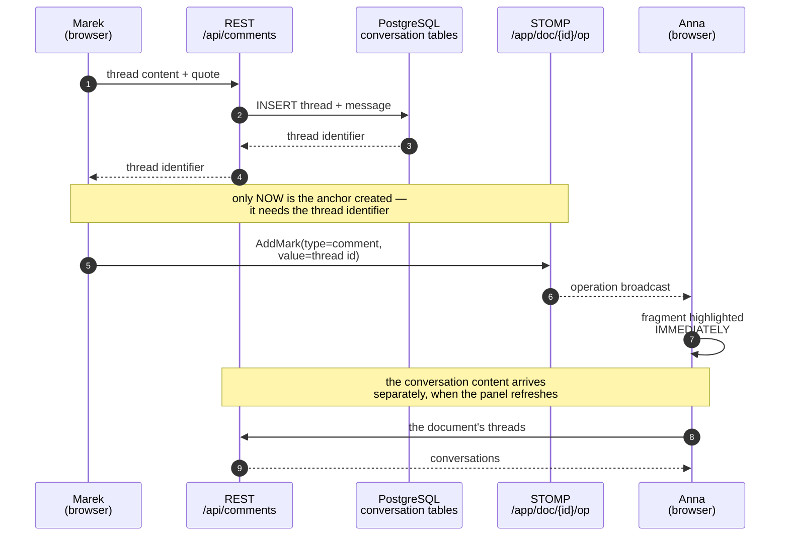

# Diagrams

## Architecture

All four RGA replicas on the diagram — two in browsers and two in backend instances — are **peers**.
There is no document owner and no ordering arbiter
([ADR-0004](adr/0004-skalowanie-poziome.md)).

Authorization is drawn on only one instance so as not to clutter the picture, but it works on every
one: **every SUBSCRIBE and SEND frame** goes through a role check
([ADR-0009](adr/0009-model-uprawnien.md)). It is not a check of "do you have access to the
document" but of "does your role permit THIS operation" — comments and edits travel the same
channel, so the distinction has to descend to the operation type.

---

## The path of a single edit

The order of the steps is not arbitrary — each one is justified in
[ADR-0003](adr/0003-historia-zmian.md) and [ADR-0004](adr/0004-skalowanie-poziome.md).

---

## Client connection states

---

## A comment — two routes, only one of which is a CRDT

The most common misunderstanding when reading this code is: "you have a CRDT, so the comments must
be in the CRDT too". They are not — and [ADR-0011](adr/0011-komentarze.md) explains why. The diagram
shows what that means for the flow.

Two things are visible here that are easy to miss in the code:

1. **The anchor is created AFTER the thread**, because it needs the thread's identifier. Between the
   two there is a window in which the thread exists without an anchor — and that is a known,
   documented consequence of this split, not an oversight.
2. **The highlight and the content arrive by different routes and at different speeds.** The
   highlight is a CRDT operation, so it appears for the other person immediately; the conversation
   travels over REST and waits for the panel to refresh. It looks like an inconsistency and is not:
   what has to merge without an arbiter is the range, not a sentence written by one person.
