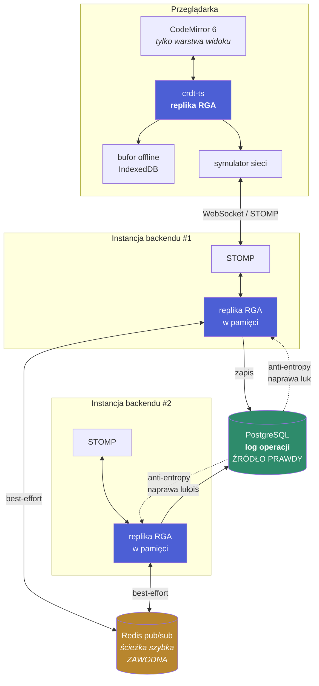
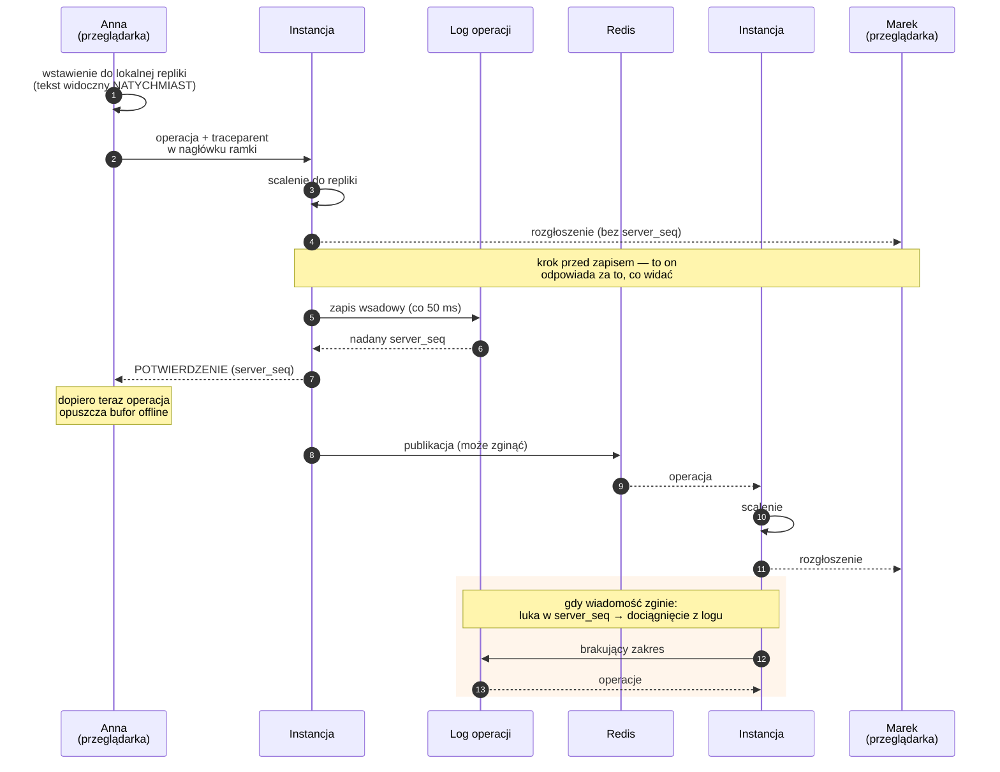
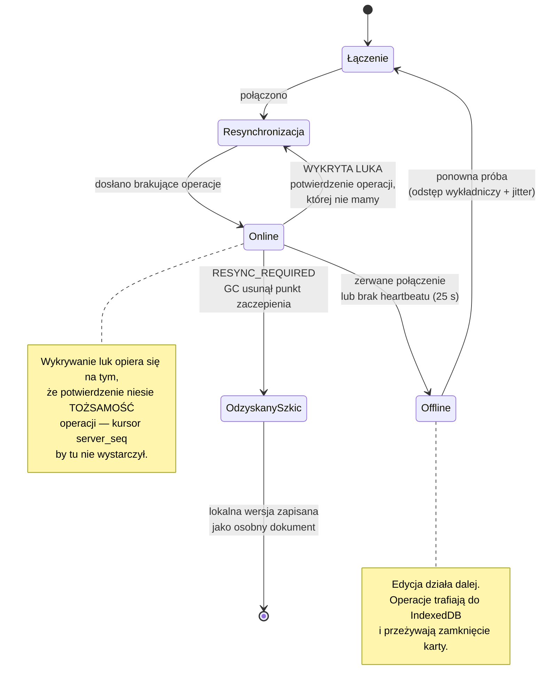

# Diagramy

## Architektura

Wszystkie cztery repliki RGA na diagramie — dwie w przeglądarkach i dwie w instancjach
backendu — są **równorzędne**. Nie ma właściciela dokumentu ani arbitra kolejności
([ADR-0004](adr/0004-skalowanie-poziome.md)).

---

## Droga pojedynczej edycji

Kolejność kroków nie jest dowolna — uzasadnienie każdego z nich w
[ADR-0003](adr/0003-historia-zmian.md) i [ADR-0004](adr/0004-skalowanie-poziome.md).

---

## Stany połączenia klienta

